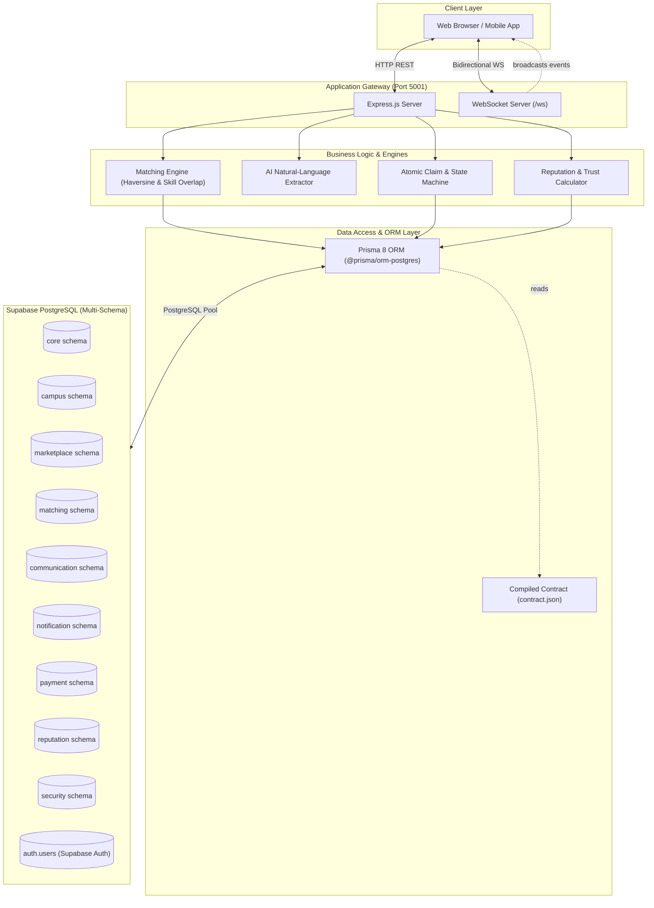
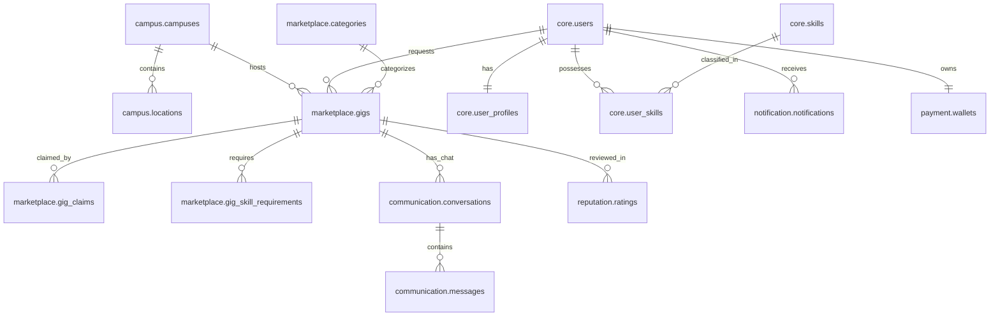
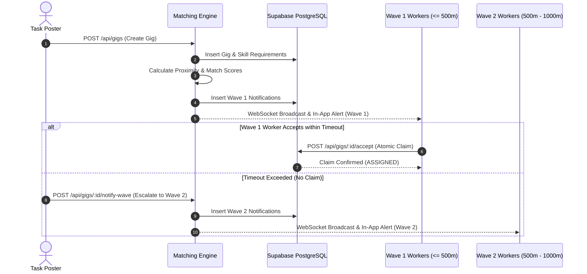
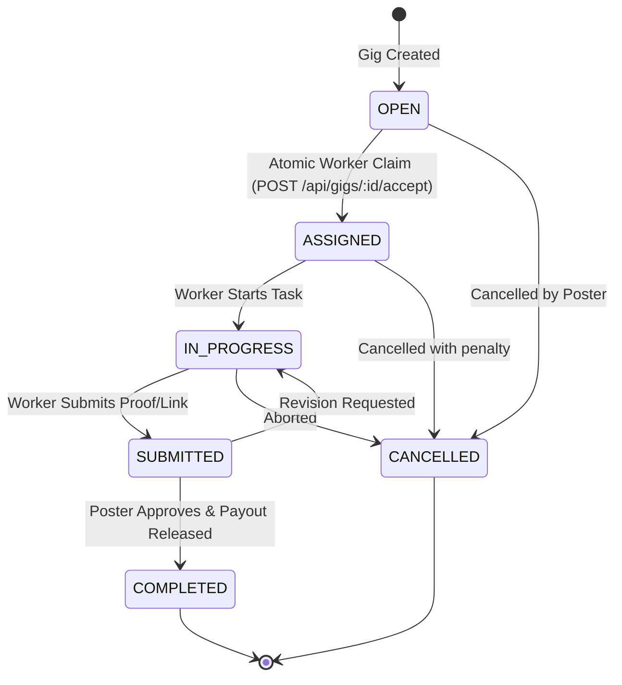
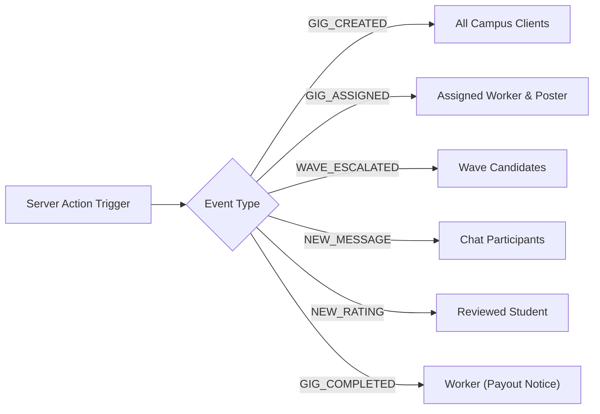
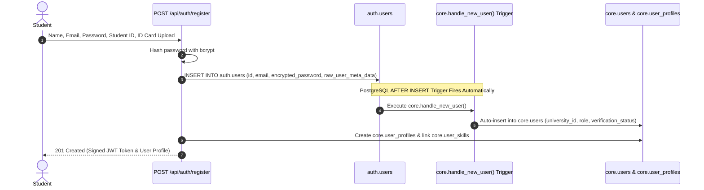

# Genie — Hyper-Local Campus Micro-Gig Platform

[](https://nodejs.org/)
[](https://supabase.com/)
[](https://www.prisma.io/)
[](#database-architecture)
[](#real-time-websocket-engine)
[](LICENSE)

> **Genie** is a production-grade, hyper-local campus micro-gig marketplace engineered for university ecosystems. It seamlessly connects students needing quick, on-demand assistance (Canva poster design, event logistics, tutoring notes, urgent deliveries, coding debugging) with peer student workers located within walking distance on campus.

---

## Table of Contents

- [1. Executive Summary & Core Value Proposition](#1-executive-summary--core-value-proposition)
- [2. System Architecture](#2-system-architecture)
- [3. Database Architecture (9 Domain Schemas)](#3-database-architecture-9-domain-schemas)
- [4. Proximity & Multi-Wave Matching Engine](#4-proximity--multi-wave-matching-engine)
- [5. Gig Lifecycle State Machine](#5-gig-lifecycle-state-machine)
- [6. Real-Time WebSocket Engine](#6-real-time-websocket-engine)
- [7. Supabase Auth & Identity Integration](#7-supabase-auth--identity-integration)
- [8. API Reference](#8-api-reference)
- [9. Project Structure](#9-project-structure)
- [10. Quick Start & Setup Guide](#10-quick-start--setup-guide)
- [11. Verification & Testing](#11-verification--testing)

---

## 1. Executive Summary & Core Value Proposition

Traditional freelance platforms (Upwork, Fiverr) fail on university campuses due to high transaction fees, complex onboarding, and an absence of geospatial proximity awareness. 

**Genie** solves campus-specific operational bottlenecks:
- **Zero Friction Delivery:** Find peers already walking near your campus building or library.
- **Micro-Reward Economy:** Escrow-backed payments calibrated for student pocket money (INR ₹50 - ₹2,000).
- **Proximity-First Waves:** Notifications broadcast in expanding concentric physical circles based on Haversine coordinates.
- **Campus Verified Peer Network:** Mandatory university registration numbers (`universityId`) and student ID card validation.
- **Race-Condition Safe:** Atomic claim resolution guaranteeing that multiple simultaneous acceptance attempts never double-assign a task.

---

## 2. System Architecture

Genie utilizes an event-driven architecture combining an Express REST API, a bidirectional WebSocket event bus, and Prisma 8 multi-schema models backed by Supabase PostgreSQL.



---

## 3. Database Architecture (9 Domain Schemas)

The PostgreSQL database is organized into **9 domain-driven application schemas**, strictly decoupling concerns across student identity, geospatial mapping, gig lifecycles, and financial escrows.



### Schema Responsibilities

| Schema | Models / Tables | Responsibility |
| :--- | :--- | :--- |
| **`core`** | `User`, `UserProfile`, `Skill`, `UserSkill`, `UserAvailability` | Application user records linked to Supabase Auth, biographical profiles, student skills, and weekly availability calendars. |
| **`campus`** | `Campus`, `CampusHours`, `Location` | Physical campus boundary definition, building codes, operating hours, and PostGIS geospatial points (`geography(Point, 4326)`). |
| **`marketplace`** | `Gig`, `Category`, `GigClaim`, `GigSkillRequirement`, `GigAttachment`, `GigEvent`, `GigStatusHistory` | Core gig lifecycles, atomic worker claims, required skill competencies, media attachments, and complete state transition histories. |
| **`matching`** | `MatchingPreference`, `MatchResult`, `MatchFeedback` | Saved student gig preferences, algorithmic rank scores, and feedback training loops. |
| **`communication`**| `Conversation`, `ConversationParticipant`, `Message` | Gig-anchored real-time messaging, unread read-markers, and soft-delete/edit tracking. |
| **`notification`** | `Notification`, `NotificationDelivery`, `NotificationPreference` | Multi-wave dispatch notifications, in-app alerts, delivery receipts, and notification channel opt-ins. |
| **`payment`** | `Wallet`, `WalletTransaction`, `GigPayment`, `Payout`, `Refund` | Double-entry student wallet balances, escrow hold/release lifecycles, and payment audit logs. |
| **`reputation`** | `Rating`, `ReputationHistory` | Multi-criteria peer reviews (communication, quality, reliability) and trust score adjustment logs. |
| **`security`** | `UserBlock`, `Report`, `ModerationAction`, `AuditLog` | Peer blocklists, incident tickets, admin moderation actions, and IP audit logging. |

---

## 4. Proximity & Multi-Wave Matching Engine

The Genie Matching Engine computes a composite score (0 to 100) for every eligible student worker on campus whenever a gig is posted.

### Multi-Factor Scoring Formula

$$\text{Composite Score} = 0.40 \cdot S_{\text{skill}} + 0.30 \cdot S_{\text{distance}} + 0.15 \cdot S_{\text{availability}} + 0.10 \cdot S_{\text{rating}} + 0.05 \cdot S_{\text{reliability}}$$

Where:
- **Skill Score ($S_{\text{skill}}$):** Semantic match evaluated against skill clusters (Exact match = 1.0, Cluster match = 0.75, Partial match = 0.50).
- **Distance Score ($S_{\text{distance}}$):** Evaluated via the Great-Circle Haversine formula:
  $$d = 2R \arcsin \left( \sqrt{\sin^2\left(\frac{\Delta \phi}{2}\right) + \cos(\phi_1)\cos(\phi_2)\sin^2\left(\frac{\Delta \lambda}{2}\right)} \right)$$
  $$S_{\text{distance}} = \max\left(0.10, 1 - \frac{d}{2500}\right)$$
- **Availability Score ($S_{\text{availability}}$):** 1.0 for "Available Now", 0.85 for "Evenings/Weekends".
- **Rating Score ($S_{\text{rating}}$):** Normalized star rating ($\frac{\text{Rating}}{5.0}$).
- **Reliability Score ($S_{\text{reliability}}$):** Historical completion rate and response speed.

### Concentric Multi-Wave Notification Flow



---

## 5. Gig Lifecycle State Machine

Gigs move through a deterministic state machine designed with race-condition prevention at the database level.



### Race-Condition Safety Guarantee
When multiple students attempt to accept a gig simultaneously, the database enforces an atomic claim pattern via `marketplace.gig_claims`. The unique constraint `UNIQUE(gig_id)` coupled with a status check ensures that **exactly one worker** is assigned, while concurrent requests immediately receive a clean `409 Conflict` HTTP response.

---

## 6. Real-Time WebSocket Engine

The backend runs a WebSocket server alongside the HTTP REST API on `ws://localhost:5001/ws`.



### Event Specification

| Event Name | Trigger Condition | Payload Data |
| :--- | :--- | :--- |
| `GIG_CREATED` | New gig posted | `{ gigId, title, budget }` |
| `GIG_ASSIGNED` | Worker successfully claims gig | `{ gigId, workerId, title }` |
| `WAVE_ESCALATED`| Gig escalated to next proximity wave | `{ gigId, wave, candidatesCount }` |
| `GIG_STATUS_UPDATED`| Status changes to `IN_PROGRESS` or `SUBMITTED` | `{ gigId, status }` |
| `GIG_COMPLETED` | Poster approves submission | `{ gigId, workerId, amount }` |
| `GIG_CANCELLED` | Task retracted | `{ gigId }` |
| `NEW_MESSAGE`   | Chat message posted in gig thread | `{ id, gigId, senderId, message, timestamp }` |
| `NEW_RATING`    | Post-gig peer rating submitted | `{ gigId, toUserId, rating }` |

---

## 7. Supabase Auth & Identity Integration

Genie integrates directly with Supabase Auth (`auth.users`) while preserving domain boundaries in `core.users`.



---

## 8. API Reference

All endpoints are mounted under `/api`.

### Authentication (`/api/auth`)

| Method | Endpoint | Description |
| :--- | :--- | :--- |
| `POST` | `/api/auth/register` | Register student account with student ID card upload |
| `POST` | `/api/auth/login` | Authenticate with email/password and receive JWT token |
| `GET` | `/api/auth/me` | Fetch currently authenticated user session details |
| `GET` | `/api/auth/demo-users` | Quick demo logins for examiners / faculty review |

### Student Profiles (`/api/users`)

| Method | Endpoint | Description |
| :--- | :--- | :--- |
| `GET` | `/api/users` | List all verified student profiles with skills & ratings |
| `GET` | `/api/users/:id` | Fetch detailed student profile with peer reviews |
| `PUT` | `/api/users/:id/location` | Dynamically update student GPS / landmark location |
| `POST` | `/api/users` | Register or update student competencies |

### Micro-Gigs (`/api/gigs`)

| Method | Endpoint | Description |
| :--- | :--- | :--- |
| `GET` | `/api/gigs` | List gigs with filter support (`category`, `status`, `search`, proximity) |
| `GET` | `/api/gigs/:id` | Fetch full gig metadata, poster info, and worker details |
| `POST` | `/api/gigs` | Create new gig and trigger algorithmic Wave 1 dispatch |
| `POST` | `/api/gigs/extract` | AI natural-language requirement and budget extractor |
| `GET` | `/api/gigs/:id/match` | View rank-ordered eligible candidates and score breakdown |
| `POST` | `/api/gigs/:id/notify-wave` | Escalate notification alert to the next proximity wave |
| `POST` | `/api/gigs/:id/accept` | Atomically claim an open task (Race-condition safe) |
| `POST` | `/api/gigs/:id/status` | Transition state (`IN_PROGRESS`, `SUBMITTED`) |
| `POST` | `/api/gigs/:id/approve` | Poster approves submission and releases worker payment |
| `POST` | `/api/gigs/:id/cancel` | Cancel task and return held escrow funds |

### In-Gig Messaging (`/api/gigs/:gigId/messages`)

| Method | Endpoint | Description |
| :--- | :--- | :--- |
| `GET` | `/api/gigs/:gigId/messages` | Retrieve conversation thread for a gig |
| `POST` | `/api/gigs/:gigId/messages` | Send message with instant WebSocket broadcast |

### Notifications (`/api/notifications`)

| Method | Endpoint | Description |
| :--- | :--- | :--- |
| `GET` | `/api/notifications/:userId` | List active in-app notifications and wave alerts |
| `PUT` | `/api/notifications/:id/read` | Mark notification as read |

### Peer Ratings (`/api/ratings`)

| Method | Endpoint | Description |
| :--- | :--- | :--- |
| `POST` | `/api/ratings/:gigId` | Submit multi-category rating (Communication, Quality, Reliability) |

---

## 9. Project Structure

```text
Genie/
├── Backend/
│   ├── package.json               # Backend dependencies (Express 5, bcryptjs, ws, cors)
│   └── server/
│       ├── uploads/               # Student ID cards & task attachments
│       └── src/
│           ├── db.js              # Primary database layer & connection verification
│           ├── db.prisma.js       # Prisma 8 runtime postgres connection
│           ├── env.js             # Root environment loader
│           ├── index.js           # Server entry point (HTTP & WebSocket setup)
│           ├── ws.js              # WebSocket connection handling & event broadcasting
│           ├── matching.js        # Haversine distance & semantic skill matching engine
│           ├── aiExtractor.js     # Natural-language task requirement parsing
│           └── routes/
│               ├── auth.js        # Supabase auth integration & registration
│               ├── users.js       # User profiles, skills, and reviews
│               ├── gigs.js        # Gig marketplace lifecycle & atomic claims
│               ├── messages.js    # In-gig chat & messaging
│               ├── notifications.js # Wave notifications & read status
│               └── ratings.js     # Peer rating calculation & trust scores
├── database/
│   └── schema.sql                 # PostgreSQL source of truth (9 schemas + triggers)
├── prisma/
│   ├── contract.prisma            # Prisma 8 multi-schema contract definition
│   ├── contract.json              # Compiled Prisma 8 runtime contract
│   └── contract.d.ts              # TypeScript type definitions for contract models
├── .env                           # Supabase DATABASE_URL and environment variables
├── package.json                   # Root package configuration (Prisma 8 ORM)
├── prisma.config.ts               # Prisma 8 toolchain configuration
└── README.md                      # Comprehensive system documentation
```

---

## 10. Quick Start & Setup Guide

### Prerequisites
- **Node.js:** v20.0.0 or higher (v24 LTS recommended)
- **Database:** Supabase PostgreSQL instance with PostGIS enabled
- **Package Manager:** npm or pnpm

### 1. Clone Repository & Install Dependencies

```powershell
# Root dependencies (Prisma 8 tooling)
npm install

# Backend dependencies
cd Backend
npm install
cd ..
```

### 2. Configure Environment Variables

Ensure `.env` in the root directory contains your Supabase credentials:

```env
DATABASE_URL="postgresql://postgres:[PASSWORD]@[HOST]:[PORT]/postgres?sslmode=require"
PORT=5001
JWT_SECRET="your_production_secret_key"
```

### 3. Generate Prisma 8 Contract (If modifying schema)

```powershell
npx prisma contract emit
```

### 4. Start Backend Server

```powershell
cd Backend
npm run server
```

You should see:
```text
🔄 Initializing Prisma 8 PostgreSQL database connection...
🚀 Gully Gigs Server running on http://localhost:5001
📡 WebSocket server ready at ws://localhost:5001/ws
✅ Supabase PostgreSQL connected via Prisma 8! (Users in database: 4)
📍 Campus context: Galgotias University [ID: 910387eb-904b-4542-9c0c-64484a797bdc]
```

---

## 11. Verification & Testing

Verify that all subsystems are healthy:

```powershell
# 1. Health check
Invoke-RestMethod http://localhost:5001/api/health

# 2. List demo campus users
Invoke-RestMethod http://localhost:5001/api/auth/demo-users

# 3. List verified student profiles
Invoke-RestMethod http://localhost:5001/api/users

# 4. List open marketplace gigs
Invoke-RestMethod http://localhost:5001/api/gigs

# 5. Check user notifications
Invoke-RestMethod http://localhost:5001/api/notifications/0ed3713c-3180-412e-adeb-9eb881ad3026
```

---

## License

This project is licensed under the [MIT License](LICENSE).

